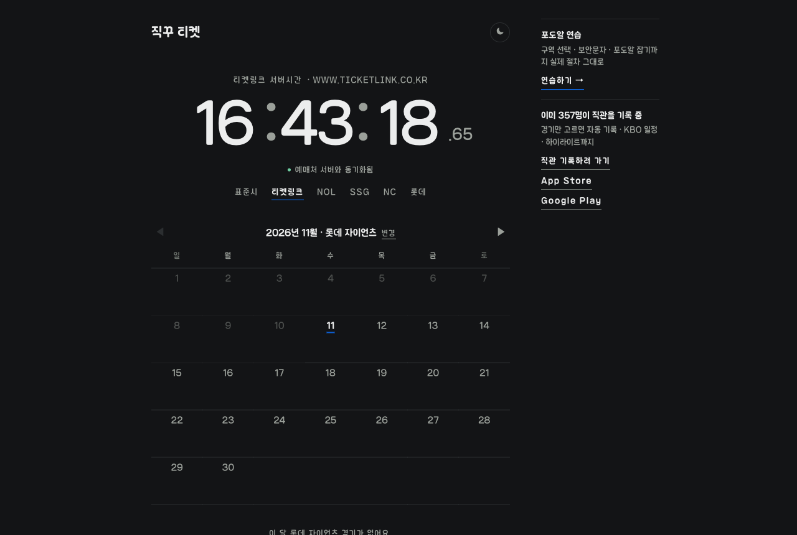
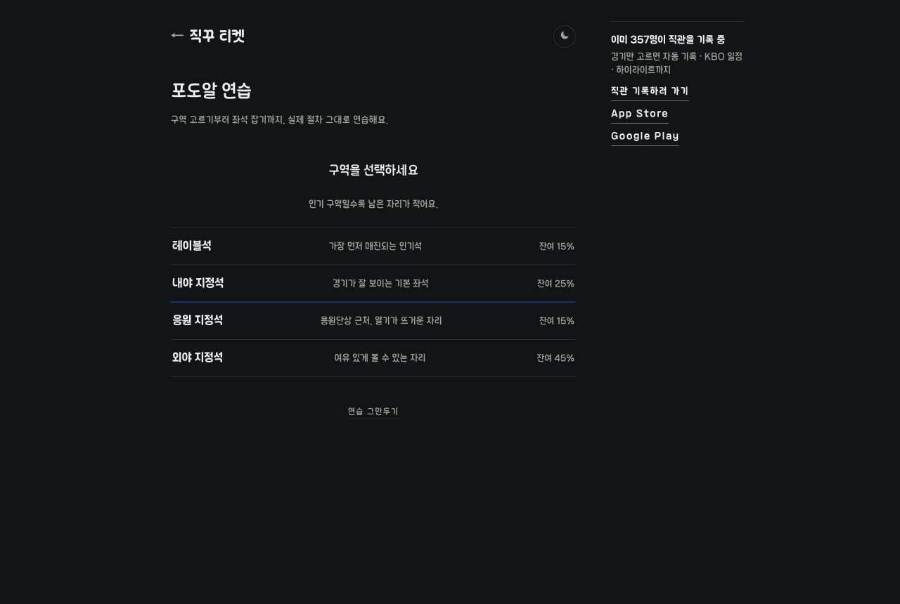
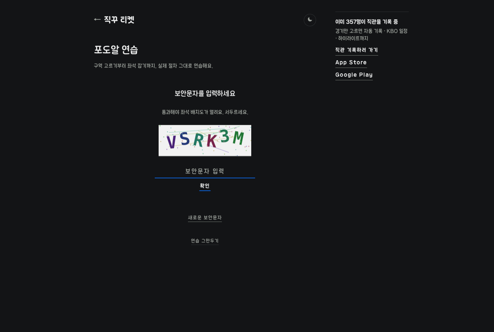

# [직꾸 티켓](https://ticket.jik-kku.com/)

❓ Problem : 야구 예매가 열릴 때마다 예매 사이트랑 서버시간 사이트를 따로 띄워 놓고 번갈아 봐야 할 때! 😮

❗️ Idea : 구단별 예매처랑 그 예매처의 서버시간을 한 화면에서 볼 수 있으면 좋지 않을까? 🤔

💯 Solution : 응원팀만 고르면 예매처 링크와 서버시간을 한 번에 보여주자!! 😁

 

## 프로젝트 소개

야구 직관 기록 앱 [직꾸](https://www.jik-kku.com)와 함께 운영하는 예매 도우미 사이트

 

## 기술 스택

Next.js, TypeScript, TanStack Query, Supabase, Vercel

 

## 기능

### 예매처 서버시간

- 티켓링크, NOL 티켓, SSG 티켓, NC, 롯데 서버시간 (밀리초 단위)
- 표준시
- 응원팀 경기 일정, 홈구단 예매처 바로가기

 

### 포도알 연습

- 구역 선택 → 보안문자 → 좌석 선점
- 난이도 3단계 (쉬움 25초, 보통 15초, 어려움 8초)
- 최고 기록 저장

 

## 서버시간 측정 방식

- 예매처 응답의 Date 헤더를 서버(Next.js API 라우트)에서 대신 읽어 옴 (브라우저는 CORS 때문에 직접 못 읽음)
- 초 단위 Date 헤더를 여러 번 요청해 밀리초까지 좁힘
- 측정 기준 평균 오차 약 -2ms
- 한화 이글스는 Date 헤더가 없어 서버시간 미지원
